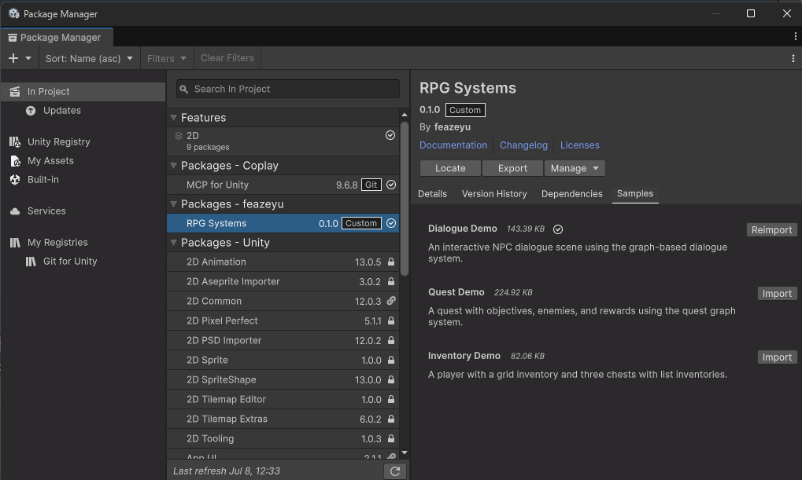
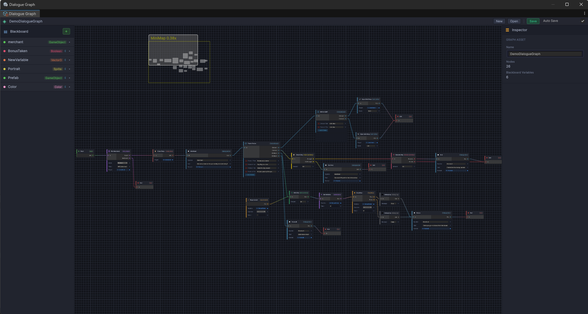
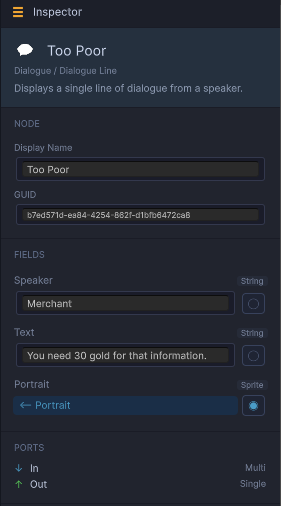
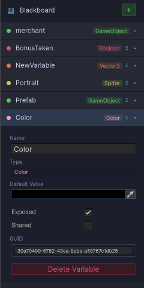
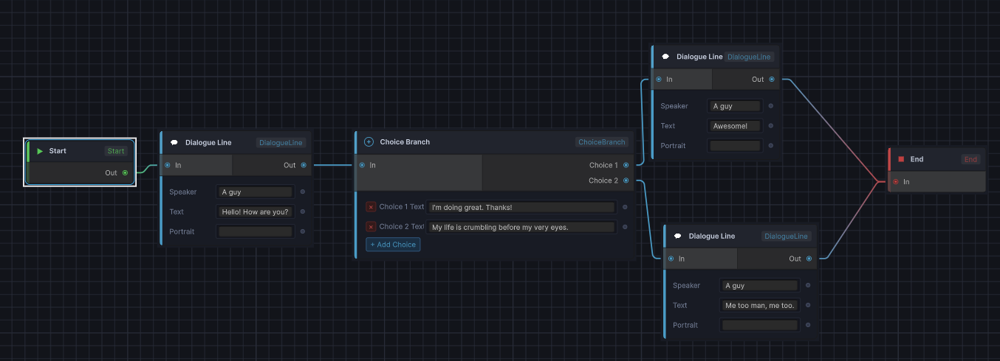

# User documentation for the RPG Framework

This framework features Graph-based **dialogue** and **quest** systems, a flexible **inventory** (grid, list, and shop), and a small **character/interaction** layer for 2D RPGs in Unity. The dialogue and quest systems share one graph execution framework, so custom nodes and blackboard variables work the same way in both.

This guide walks through every system and shows how to set each one up to reproduce the functionality of the bundled sample scenes (**Dialogue Demo**, **Quest Demo**, **Inventory Demo**).

---

## Table of contents

1. [Installation & samples](#1-installation--samples)
2. [The graph framework](#2-the-graph-framework)
3. [The graph editor window](#3-the-graph-editor-window)
4. [The blackboard](#4-the-blackboard)
5. [Dialogue system](#5-dialogue-system)
6. [Quest system](#6-quest-system)
7. [Inventory system](#7-inventory-system)
8. [Shop system](#8-shop-system)
9. [Character & interaction](#9-character--interaction)
10. [Extending the framework](#10-extending-the-framework)

---

## 1. Installation & samples

**Requirements:** Unity **6000.0** (developed against 6000.0.43f1). The dependencies `com.unity.ugui` and `com.unity.inputsystem` install automatically.

1. Open **Window -> Package Manager -> + -> Add package from git URL -> https://github.com/feazeyu/RPGFramework** (or *Add package from disk…* and pick the package's `package.json`).
2. In the package's **Samples** tab, import the demos you want:
   - **Dialogue Demo** — an interactive NPC with branching dialogue, requirements, and a shop.
   - **Quest Demo** — a quest chain with objectives, enemies and timers.
   - **Inventory Demo** — a player grid inventory and chests with list inventories.

Samples import into `Assets/Samples/RPG Systems/<version>/<sample name>/` and each contains a ready-to-play scene (`DialogueDemo.unity`, `QuestDemo.unity`, `InventoryDemo.unity`).

> The samples use TextMeshPro. If prompted, import the TMP Essentials via **Window → TextMeshPro → Import TMP Essential Resources**.

**Demo controls:** WASD / arrow keys to move, **E** to interact, **I** to toggle the player inventory (Inventory Demo).



---

## 2. The graph framework

Both dialogue and quests are authored as **graph assets** (ScriptableObjects) and executed at runtime by a **runner** (a MonoBehaviour).

| Concept | What it is |
|---|---|
| **Graph asset** | A `ScriptableObject` (`DialogueGraphAsset`, `QuestGraphAsset`) holding nodes, edges, and a blackboard. Authored in the graph editor window. |
| **Node** | One step of logic. Has typed **input/output ports** and **fields** (e.g. a Dialogue Line's `Speaker` and `Text`). |
| **Edge** | A connection from one node's output port to another node's input port. Execution follows edges. |
| **Blackboard** | The graph's variable store. Fields on nodes can hold an inline value *or* link to a blackboard variable. |
| **Runner** | The MonoBehaviour that executes a graph: `DialogueRunner` and `QuestRunner` both extend the shared `GraphRunner`. |
| **Node handler** | A C# class implementing `IGraphNodeHandler` that defines what one node type does at runtime. |

**Execution model.** When a runner starts, it clones the blackboard (the asset is never mutated at runtime), finds the **Start** node, and walks the graph as a coroutine. Each node's handler runs, then tells the runner which output port to follow. Wiring the Start node's `Out` (or any Multi-capacity output) to several nodes **forks concurrent flow branches** — this is how quests run several objectives in parallel.

Key `GraphRunner` members (available on both runners):

- `Graph` — the asset to execute (assign in the Inspector).
- `StartGraph()` / `StopGraph()` — begin / cancel execution. `IsRunning` tells you the current state.
- `OnGraphStarted`, `OnGraphEnded` — UnityEvents fired at the run boundaries.
- `SetBlackboardValue(name, value)` — write a runtime blackboard variable by name from game code.

---

## 3. The graph editor window

Both graph types use the same editor window layout; only the node palette differs.

**Opening a graph:**
- **Double-click** a Dialogue Graph or Quest Graph asset in the Project window, or
- open **Window → Dialogue Graph** / **Window → Quest Graph** and use the toolbar's **Open** button.



**Layout:**

- **Toolbar** — **New** (create an asset), **Open** (asset picker), **Save**, and an **Autosave** toggle. The label shows which asset is open.
- **Canvas** — the node graph. **Right-click → Add Node** opens the palette, organized by category (Flow, Dialogue, Logic, Quest, Objectives, Gates, …). Drag from a port to another port to connect. Standard GraphView navigation applies (scroll to zoom, middle/alt-drag to pan, box-select, `Delete` to remove).
- **Blackboard panel** — create and edit the graph's variables (see [section 4](#4-the-blackboard)).
- **Inspector panel** — shows the selected node's fields. Each field has a **link toggle (◯/◉)** next to it: ◯ means the field holds an inline value, ◉ means it is linked to a blackboard variable and resolves that variable's value at runtime. Click it to pick a variable of a compatible type.



> **Note:** asset references (Sprites, GameObjects, other graphs, quests…) can't be stored inline on a node — they need a blackboard variable of that type. They also cannot be set in the blackboard, unless they are prefabs, due to unity's behavior. Use "Find object" nodes to fill them in.

---

## 4. The blackboard

Every graph asset owns a blackboard: a list of named, typed variables.

**Supported types:** Bool, Int, Float, String, Vector2, Vector3, Color, GameObject, Transform, Sprite, AudioClip, DialogueGraph (dialogue graphs), and Quest / QuestGraph (quest chains).

Add variables with the blackboard panel's **+** button, pick a type, and set a default value. Each variable has two flags:

- **Exposed** — surfaces the variable in an **Exposed Variables** section on the runner's Inspector (`DialogueRunner`, `QuestRunner`, …), where each scene instance can **override its initial value**. Two NPCs can run the same graph with, say, different `Speaker` or `Portrait` values. Overrides are applied when the runner first builds its runtime blackboard; the graph asset itself is never modified.
- **Shared** — makes the variable **global for the play session**: every running graph that contains a variable with the same identity resolves to one shared instance. Writing it in one dialogue is immediately visible in a quest's Condition node, and vice versa. Shared values are wiped at the start of every play session and never written back to the asset. A Shared variable cannot be overridden per instance (Exposed overrides are skipped for it), since it resolves to one global value.

**Runtime isolation.** Non-shared variables are cloned per run — two NPCs running the same graph don't interfere, and nothing you change in play mode persists to the asset.

**Text interpolation.** Any text field resolved as display text (e.g. Dialogue Line `Text`/`Speaker`) supports `{VariableName}` tokens, replaced with the runtime value: `"Hello {PlayerName}!"`. Use `{{` and `}}` for literal braces. Unknown variable names are left as the literal `{Name}` token so typos are visible on screen.



---

## 5. Dialogue system

### 5.1 Creating a dialogue graph

**Assets → Create → RPGFramework → Dialogue → Dialogue Graph**, then double-click it to open the editor.

A minimal conversation is: **Start → Dialogue Line → … → End**.



### 5.2 Dialogue node reference

**Dialogue nodes**

| Node | Ports | What it does |
|---|---|---|
| **Dialogue Line** | In → Out | Shows one line (`Speaker`, `Text`, `Portrait` sprite via linked variable), then waits until the runner's `Advance()` is called (the Continue button). |
| **Choice Branch** | In → Choice 1..N | Presents choices; each `Choice N` output port is one option with its `Choice N Text` field. Use the node's **+ Add Choice / remove** buttons to change the number of choices. Waits for `SelectChoice(index)`. |
| **Requirement** | Out only | Conditionally **hides a choice**: connect its `Out` to the input of the node that *follows* the choice. The choice is only offered while `Variable Operator Value` holds (e.g. `HasKey == True`). Multiple requirements on one target must all pass. |

> **Note:** if every choice of a Choice Branch is hidden by requirements, the branch tries to follow a port named `Out` — with the default ports that ends the dialogue. Keep at least one requirement-free choice, or account for the early end.

**Logic & flow nodes** (shared with quests)

| Node | Ports | What it does |
|---|---|---|
| **Start / End** | — | Entry point / terminates execution. Start's `Out` may fan out to fork parallel branches. |
| **Condition** | In → True / False | Compares a blackboard variable against a value (`==, !=, >, >=, <, <=`; numeric, bool, or string comparison) and routes accordingly. |
| **Set Variable** | In → Out | Writes a value to a blackboard variable. Combine with **Shared** variables to persist facts across conversations. |
| **Run Subgraph** | In → Out | Executes another Dialogue Graph inline. Link the `Graph` field to a **DialogueGraph blackboard variable** holding the sub-asset. |
| **Trigger Event** | In → Out | Raises the named event channel on the global `GraphEventBus` (waking any Wait For Event node listening for it, in this or any other running graph). Dialogue runners additionally fire their `OnEventTriggered(string)` UnityEvent — hook game reactions there. |
| **Wait For Event** | In → Out | Suspends the branch until its channel is raised — by a Trigger Event node or by game code calling `GraphEventBus.Raise("Channel")`. Only raises that happen *after* the node starts waiting count; channels are plain strings, matched exactly. |
| **Debug Log** | In → Out | Prints `Message` to the console (supports `{Var}` interpolation). |
| **Find Object** | In → Found / NotFound | Finds a scene GameObject by name or tag and stores it in a linked GameObject variable. |
| **Spawn Prefab** | In → Out / Failure | Instantiates a prefab from a GameObject variable, optionally under a `Parent` Transform, optionally storing the instance in a `Result` variable. |

**Inventory & shop nodes** (require the [Inventory](#7-inventory-system)/[Shop](#8-shop-system) systems in the scene)

| Node | Ports | What it does |
|---|---|---|
| **Give Item** | In → Success / Failure | Adds `Count` of item `ItemId` to the `IItemContainer` on the `Target` GameObject (linked variable). |
| **Check Currency** | In → Enough / NotEnough | Tests the player wallet's balance against `Amount`. |
| **Add / Remove Currency** | In → Out (Remove: Success / Failure) | Changes the `PlayerWallet` balance. |
| **Open / Close Shop** | In → Out | Opens/closes the shop UI on the `Target` GameObject (a `Shopkeep` or shop UI, via linked variable). |

### 5.3 Scene setup (recreating the Dialogue Demo)

The Dialogue Demo consists of a player, an NPC, and one dialogue UI canvas. To build the same thing:

**1. The player.** Create a sprite with:
- `Rigidbody2D` (gravity scale 0 for top-down) and a non-trigger `Collider2D`,
- `Interactor` (from `Feazeyu.RPGSystems.Character`),
- a movement script. The sample's `DemoPlayer` polls the keyboard: WASD/arrows to move, **E** calls `Interactor.InteractWithClosest()`.

**2. The dialogue UI.** The sample ships a ready **`DialogueCanvas.prefab`** — drop it into the scene, or build your own Canvas with a `DialogueUI` component and assign its fields:

| DialogueUI field | Meaning |
|---|---|
| Panel | Root GameObject shown/hidden with the dialogue. |
| Speaker Name Text / Dialogue Text | TMP texts for the line. |
| Portrait Image | Optional speaker portrait. |
| Continue Button | Its OnClick should call `DialogueUI.OnContinueClicked` (advances the line). |
| Choices Container | Parent transform the choice buttons are instantiated under. |
| Choice Button Prefab | Button template for one choice (with a TMP label). |

`DialogueUI` is *bound* to a runner at dialogue start via `DialogueUI.Bind(runner)`; it then displays lines, spawns choice buttons (clicks call `SelectChoice`), and hides itself when the graph ends. One UI can serve any number of NPCs.

> 📷 *Screenshot: the DialogueCanvas hierarchy and the DialogueUI component in the Inspector with all fields assigned.*

**3. The NPC.** Create a sprite with:
- a **trigger** `Collider2D` (the interaction range),
- `Interactable` (fires `OnInteract`, `OnAreaEnter`, `OnAreaExit`),
- `DialogueRunner` with your graph assigned to **Graph**,
- a small trigger script like the sample's `NPCDialogueTrigger`: on `Interactable.OnInteract` it calls `dialogueUI.Bind(runner)` then `runner.StartDialogue()`; on trigger exit it calls `runner.StopGraph()` so walking away closes the dialogue; it also toggles an "E to talk" prompt object.

> 📷 *Screenshot: the NPC's Inspector — Interactable, DialogueRunner (with graph assigned), and the dialogue trigger script wired together.*

**4. Press Play**, walk to the NPC, and press **E**.

> 📷 *Screenshot: the running dialogue with choice buttons visible.*

### 5.4 Driving dialogue from code / custom UI

If you don't use `DialogueUI`, wire the runner's events yourself:

```csharp
runner.OnDialogueLine.AddListener((speaker, text, portrait) => ShowLine(...));
runner.OnChoicesPresented.AddListener(choices => ShowButtons(choices)); // call runner.SelectChoice(i) on click
runner.OnEventTriggered.AddListener(channel => ReactTo(channel));       // Trigger Event nodes
runner.OnVariableSet.AddListener((name, value) => ...);                  // Set Variable nodes
runner.OnGraphEnded.AddListener(CloseUI);
runner.StartDialogue();
// call runner.Advance() on your "next" input
```

---

## 6. Quest system

Quests come in three flavours:

| Asset | Create via | Runs on |
|---|---|---|
| **Quest Graph** (Single) | Assets → Create → RPGFramework → Quest → **Quest Graph** | `QuestRunner` |
| **Quest Chain** | Assets → Create → RPGFramework → Quest → **Quest Chain** | `QuestChainRunner` |
| **Simple Quest** | Assets → Create → RPGFramework → Quest → **Simple Quest** | no runner — plain state asset |

A **Single** graph is a quest's internal logic (objectives, rewards, outcomes). A **Chain** is a dependency graph *of quests* — its editor palette is intentionally reduced (Start, End, Condition, Set Variable, **Quest Reference**), and edges between Quest Reference nodes mean *prerequisite*. A **Simple Quest** is just title + description + state with `Start()/Complete()/Fail()/Reset()` and events — for quests that need no graph logic. Its runtime state auto-resets at the start of every play session.

### 6.1 Single quests

Add a **`QuestRunner`** to a scene GameObject, assign the Quest Graph, and call `StartQuest()` (from code, a UnityEvent, or the sample's `AutoStartQuest` helper which starts it one frame after load).

A typical quest graph: **Start → Run Dialogue (offer) → Condition (accepted?) → objectives → Reward → Complete Quest**, with `Failed` ports and a **Fail Quest** node for the failure path.

> 📷 *Screenshot: the Quest Demo's QuestDemoGraph open in the Quest Graph window.*

**Quest structure nodes**

| Node | Ports | What it does |
|---|---|---|
| **Objective** (manual) | In → Completed / Failed | A generic objective. It waits until *your code* calls `runner.CompleteObjective(nodeGuid)` or `FailObjective(nodeGuid)`. Fields: Title, Description, Optional. |
| **Reward** | In → Out | Fires `OnRewardGranted` with XP, Currency, an Item (link to a ScriptableObject variable, e.g. an `ItemInfo`), and Quantity. Granting is left to your listener — see below. |
| **Complete Quest** | In | Terminal: result = Completed, ends the graph. |
| **Fail Quest** | In | Terminal: result = Failed with a `Reason` string. |
| **Spawn Item** | In → Success / Failure | Instantiates the item prefab registered under `ItemId` and puts it into the `IItemContainer` on the `Target` GameObject (linked variable). This is the built-in way to hand out item rewards. |
| **Run Dialogue** | In → Out | Runs a Dialogue Graph inline (e.g. the NPC offering the quest). Link `Graph` to a **DialogueGraph blackboard variable**. Fires the runner's `OnDialogueStarted(DialogueRunner)` — bind your `DialogueUI` to that runner there. Follows Out when the dialogue ends. |

> **Offer/accept pattern (used by the Quest Demo):** the offer dialogue sets a **Shared** variable (e.g. `Accepted = True/False`) with a Set Variable node behind each choice; back in the quest graph, a **Condition** on that variable routes to the objectives or to nothing (letting the quest end → aborted → re-offerable).

**Built-in objective nodes** (all have In → Completed / Failed and Title / Description / Optional fields)

| Node | Key fields | Completes when… |
|---|---|---|
| **Kill Count** | Tag (default `Enemy`), Count | the player kills `Count` entities carrying the tag. A "kill" is an `Entity` whose `OnDeath` fires (Health reaching zero does this). Newly spawned tagged enemies are picked up automatically (rescan every second). |
| **Reach Location** | Target (Transform var), Radius | the player is within `Radius` of `Target`. |
| **Collect Item** | ItemId, Count, Inventory (GameObject var) | the inventory holds **at least** `Count` of the item — items owned beforehand count. |
| **Accumulate Item** | ItemId, Count, Inventory | the player acquires `Count` **new** items after the objective starts (net: dropping decrements, so drop + re-collect counts once). |
| **Deliver Item** | ItemId, Count, NPC (GameObject var), Inventory | the player **interacts with the NPC** while carrying ≥ `Count`; the items are removed on delivery. |

If the `Inventory` field is left unlinked, objectives fall back to the first `InventoryList`/`InventoryGrid` found in the scene.

Chain objectives sequentially by wiring `Completed → In` of the next one, or run them in parallel by fanning out from Start / a previous node.

**Modifier nodes — gates, timers, resets**

Gates are *decorators*: they have only an `Out` port, which you wire **into the objective's In port**. While the gate's condition is false, that objective's progress does not count.

| Node | What it gates |
|---|---|
| **Flag Gate** | A blackboard variable comparison (e.g. `InZone == True`). Pair with the **`ZoneFlag`** component for collider-driven zones. |
| **Location Gate** | Actor within `Radius` of `Target`. `Subject = Player` tests the player; `Subject = Subject` tests the event's subject (e.g. *where the enemy died*). |
| **Item Gate** | An inventory holding `Count` of `ItemId` (operator configurable) — "while carrying X". |

| Node | Ports | What it does |
|---|---|---|
| **Timer** | Begin → Timeout | Starts when a flow token enters `Begin`; fires `Timeout` after `Seconds`. `AutoRestart` re-arms it as a perpetual watchdog. The runner exposes `HasActiveTimer` / `TimerRemaining` for HUD countdowns, and fires `OnTimerTimeout`. |
| **Reset Progress** | In, Target →, Out | When triggered, wipes the progress counters of every objective its `Target` port is wired to (reference-only — it never re-runs them), then follows Out. |

A classic combination: *"kill 5 wolves within 60 s"* = Start forks to both the Kill Count objective and a Timer; `Timeout → Reset Progress` whose `Target` points at the objective (or `Timeout → Fail Quest` for a hard fail).

> 📷 *Screenshot: an objective with a gate wired into its In port, plus a Timer → Reset Progress pair targeting it.*

**`ZoneFlag` setup** (for "while in this zone" objectives):
1. Put `ZoneFlag` on a GameObject with a trigger `Collider2D` shaped like the zone.
2. Point its **Runner** field at the `QuestRunner`.
3. Set **Variable Name** to a Bool blackboard variable on the quest graph.
4. Add a **Flag Gate** (`Variable == True`) to the objective. The player (tag `Player` by default) entering/leaving toggles the flag — no per-frame distance checks.

**QuestRunner events & API** (for HUDs and game logic)

- Events: `OnObjectiveStarted/Completed/Failed(ObjectiveInfo)`, `OnRewardGranted(RewardInfo)`, `OnQuestCompleted`, `OnQuestFailed(string reason)`, `OnQuestEnded(QuestResult)`, `OnTimerTimeout`, `OnDialogueStarted(DialogueRunner)`.
- API: `StartQuest()`, `AbortQuest()`, `ForceFailQuest(reason)`, `CompleteObjective(guid)` / `FailObjective(guid)` (manual Objective nodes), `GetProgress(guid)` → an `ObjectiveProgress` with `Current`/`Required` for live counters, `Result`, `FailureReason`.
- **Rewards are event-driven:** the Reward node only *announces* the reward. Handle `OnRewardGranted` yourself (grant XP/currency), or derive from the **`QuestRewardHandler`** component (add it next to the runner and override `OnRewardGranted`). Item rewards are easiest via the **Spawn Item** node, which physically adds the item to an inventory.

### 6.2 Quest chains

A chain graph contains **Quest Reference** nodes, each linked (via the chain's blackboard) to a Quest Graph or Simple Quest variable. An edge **A → B** means *B unlocks when A completes*.

Setup:

1. Create the chain asset: **Assets → Create → RPGFramework → Quest → Quest Chain**.
2. In its blackboard, add a **QuestGraph** (or **Quest**, for simple quests) variable per quest and assign the assets.
3. Add a **Quest Reference** node per quest, link each node's `Quest` field to the matching variable, and wire the prerequisite edges.
4. In the scene, add a **`QuestChainRunner`** and assign the chain to **Chain**. Options: **AutoStart** and **MaxActiveQuests** (default 1).

> 📷 *Screenshot: a chain graph with three Quest Reference nodes wired as prerequisites.*

**Lifecycle.** Every entry starts **Locked**; entries whose prerequisites are all Completed become **Available** (announced via `OnAvailableQuestsChanged`). Calling `StartQuest(chainNodeGuid)` spawns a fresh child `QuestRunner` for that quest (state → **Active**), and its outcome moves the entry to **Completed** / **Failed** — an *aborted* quest (e.g. offer declined) returns to **Available**, so it can be offered again. When every quest resolves, `OnChainCompleted` fires.

- Simple-quest entries spawn no runner — game code drives them by calling `QuestAsset.Complete()` / chain `NotifyExternalQuestCompleted(guid)`.
- Events: `OnQuestStarted/Completed/Aborted(QuestEntry)`, `OnQuestFailed(QuestEntry, reason)`, `OnAvailableQuestsChanged(List<QuestEntry>)`, `OnChainCompleted`.
- API: `StartChain()`, `IsStarted`, `GetAvailableQuests()`, `StartQuest(guid)`, `GetActiveRunner(guid)`, `ActiveRunners`, `AbortQuest(guid)` / `AbortActiveQuest()`, `NotifyExternalQuestCompleted/Failed(guid)`.

**The Quest Demo's NPC pattern (`QuestGiver`).** One NPC drives the whole chain from its `Interactable.OnInteract`:

```csharp
public void OfferNextQuest()
{
    if (!chain.IsStarted) chain.StartChain();
    if (chain.ActiveRunners.Count > 0) return;      // a quest is running — don't double-start
    var available = chain.GetAvailableQuests();
    if (available.Count > 0)
        chain.StartQuest(available[0].ChainNodeGuid);
}
```

Because each quest graph opens with a **Run Dialogue** offer, talking to the NPC plays the offer immediately; declining aborts the quest and the next interaction re-offers it. The same interaction also serves **Deliver Item** objectives (delivery happens on interact), since no new quest is offered while one is active.

**The Quest Demo's HUD (`QuestDemoUI`).** Binds to the *chain* (not a fixed runner): on `OnQuestStarted` it grabs the fresh runner via `GetActiveRunner(entry.ChainNodeGuid)`, mirrors its objective events into a checklist, appends live `(current/required)` counters from `GetProgress(guid)`, shows the Timer countdown from `HasActiveTimer`/`TimerRemaining`, and binds a `DialogueUI` on `OnDialogueStarted`. Use it as the reference implementation for your own quest log.

> 📷 *Screenshot: Quest Demo running — HUD with objective checklist, live counter, and timer.*

**Demo enemies & pickups.** `DemoEnemy` (`Entity` + `Health` + `Interactable`, tagged `Enemy`) sets its Health to 0 on interact, firing `Entity.OnDeath` — which is exactly what Kill Count listens for. `ItemPickup` (an `Interactable` subclass) adds `amount` of `itemId` to the player's `IItemContainer` on interact and despawns.

---

## 7. Inventory system

### 7.1 Items

An item is two assets working together:

1. **`ItemInfo`** (ScriptableObject) — **Assets → Create → RPGFramework → Items → ItemInfo**. Fields: **id** (must be unique — it's how every system references the item), Name, Icon, Target, Tier (1–5), Description, **Shape** (the set of grid cells the item occupies in a grid inventory), and Stat Effects.
2. **An item prefab** — a GameObject with the **`Item`** component pointing at the `ItemInfo` (plus its visuals). Place the prefab in a **`Resources/Items/`** folder.

The **`InventoryManager`** (singleton) maps ids → item prefabs. It loads everything under `Resources/Items/` automatically on Awake (call `InventoryManager.Instance.ReloadItems("Items")` to re-scan, as the demos do) and exposes `GetItemById(id)`. It also defines the global **cell size** for grid UIs. Create one via **GameObject → RPGFramework → Inventory → Create Inventory Manager** — or let it auto-create itself on first access.

The package ships example items (Apple id 10, Burn id 5, Fury, Overkill) under `Runtime/Resources/Items/`.

> 📷 *Screenshot: an ItemInfo asset in the Inspector, showing id, icon, and the shape editor.*

### 7.2 Grid inventory

A spatial, shape-aware inventory (items occupy their `ItemShape` cells; drag & drop; optional stacking).

**Setup:** right-click in the Hierarchy → **GameObject → RPGFramework → Inventory → Create Inventory Grid** (under a Canvas). This creates a grid with an `InventoryGrid` + `InventoryGridGenerator` (which builds the slot UI). Configure on the `InventoryGrid`:

- **rows / columns** — grid dimensions.
- **allowStacking** — allow same-id items to stack in one cell.
- **persistPlayModeChanges** — keep play-mode edits after exiting play mode (editor convenience).

The package also ships a ready **`PlayerGridInventory.prefab`** (and `PlayerListInventory.prefab`) under `Runtime/Prefabs/Inventory/`.

**Using it:**

- `TryAddItem(itemId, count)` — add by id (first free spot); also `PutItem(position, item)` / `RemoveItem(position)` / `GetItem(position)` for positional control.
- `OpenInventory()` / `CloseInventory()` / `ToggleInventory()` — show/hide. The Inventory Demo's player toggles it on **I**.
- `OnItemAdded` / `OnItemRemoved` (`Action<int itemId, int count>`) — change notifications (quest objectives use these for exact counting).
- Items are dragged between slots and between containers with the mouse; dropping outside a valid cell returns the item.

In code, prefer the **`IItemContainer`** interface (`TryAddItem`, `RemoveItem(itemId, count)`, `CountItem(itemId)`, `PutItem`) — grids, lists, and slots all implement it, so pickups/quests/shops work against any of them.

> 📷 *Screenshot: the grid inventory open with a multi-cell item being dragged.*

### 7.3 List inventory

A linear inventory of stackable slots — ideal for chests and simple storage.

**Setup:** **GameObject → RPGFramework → Inventory → Create Inventory List** (under a Canvas). Configure `InventoryList`: **EnableSlotCapacity** + **capacity** (max slots), **scrollSensitivity**. It supports the same `TryAddItem` / open/close/toggle API, drag & drop with grids, and `OnItemAdded`/`OnItemRemoved`.

**Recreating the Inventory Demo:**
1. Player: `Rigidbody2D` + `Interactor` + `InventoryGrid` reference; the sample's `InventoryDemoPlayer` moves with WASD, interacts with **E**, toggles the grid with **I**.
2. Chests: each has a trigger `Collider2D`, `Interactable`, an `InventoryList`, and the sample's `ChestController` — `Interactable.OnInteract` → `Toggle()`, which opens/closes the list; leaving the trigger area closes it and hides the "E" prompt.
3. `InventoryDemoBootstrap` seeds the chests at startup by distributing every item id registered in the `InventoryManager` round-robin (`TryAddItem`).

> 📷 *Screenshot: Inventory Demo — player grid inventory and an open chest list side by side mid-drag.*

---

## 8. Shop system

Shops are a layer on top of the inventory UIs: the player buys by dragging items *out* of the shop and sells by dropping items *into* it.

**1. Stock asset.** **Assets → Create → RPGFramework → Shop → ShopInventory**. Add listings: **itemId**, **price**, **stock** (−1 = infinite). At runtime the shop works on a **clone** of this asset, so purchases never mutate your authored stock.

**2. Shop UI.** **GameObject → RPGFramework → Shop → Create Shop Grid** (or **Create Shop List**). `ShopGridUI` extends `InventoryGrid`:

- Dragging an item out **charges** the player via `IShopCurrency`; if they can't afford it, the drag is blocked.
- Dropping an item in **sells** it for `sellRatio` × its listing price (default 0.5).
- **priceLabelPrefab** — optional price-tag prefab (the Dialogue Demo sample ships `PriceLabel.prefab`); a procedural label is generated if empty.
- **currencyProvider** — any `IShopCurrency` MonoBehaviour; falls back to the `PlayerWallet` singleton.

**3. Shopkeep NPC.** **GameObject → RPGFramework → Shop → Create Shopkeep**, or add the **`Shopkeep`** component (an `Interactable`) yourself. Assign its **shopInventory** and the grid- and/or list-UI; interacting toggles the shop, and **closeOnAreaExit** closes it when the player walks away.

**4. Wallet.** Add a **`PlayerWallet`** to the scene (or let it auto-create) — starting balance is serialized (default 100), `TrySpend(amount)` / `Add(amount)`, `OnBalanceChanged(int)` for a coin HUD.

**Dialogue integration.** The Dialogue Demo's merchant opens its shop from conversation: an **Open Shop** node (Target linked to a GameObject variable holding the Shopkeep) plus the **Check / Add / Remove Currency** nodes for haggling logic, and **Close Shop** on farewell.

> 📷 *Screenshot: the merchant's shop grid open with price labels, wallet balance visible.*

---

## 9. Character & interaction

The character layer is deliberately small — enough to power the demos and the quest hooks.

**Entity & resources.** Add **`Entity`** plus any of **`Health`**, **`Mana`**, **`Stamina`** (all extend `Resource`) to a character. `Entity.Awake` collects the `Resource` components into its `resources` dictionary and raises **`OnDeath`** (a UnityEvent) when Health reaches zero. Quest **Kill Count** objectives count any tagged `Entity` whose `OnDeath` fires — so an enemy needs exactly: `Entity` + `Health` + the matching **Tag**, and something that damages it (`health.Points = 0` in the demo).

**Interaction.** Two components form the interaction system used everywhere (dialogue triggers, chests, pickups, shopkeepers, quest delivery):

- **`Interactable`** (on the world object, needs a trigger `Collider2D`) — raises `OnInteract`, `OnAreaEnter`, `OnAreaExit`. Subclass it (`ItemPickup`, `Shopkeep`) or wire the UnityEvents in the Inspector.
- **`Interactor`** (on the player) — tracks in-range interactables; call `InteractWithClosest()` from your input handling.

**Player controller.** The demos use small self-contained scripts (`DemoPlayer`, `InventoryDemoPlayer`) that poll `Keyboard.current` — copy one as a starting point. The package also provides the fuller **`PlayerController`** (extends `Entity`): top-down movement, mouse-aim weapon rotation (via `RotateTowardsPoint`), attack state, and interaction, driven by Input System callbacks (`OnMove`, `OnLook`, `OnInteract`, `OnAttack`) — add a `PlayerInput` component with **Behavior = Invoke Unity Events** and wire the four actions to those methods. A ready-made **`Char.prefab`** (with animations) ships under `Runtime/Prefabs/Character/`.

**Stats.** `Stat` / `StatEffect` / `Scaling` (in `Runtime/Core/Stats/`) implement a value + modifier system; `ItemInfo.StatEffects` carries an item's effects. Apply them to your own combat math as needed.

> 📷 *Screenshot: an enemy's Inspector — Entity, Health, Interactable, tag set to Enemy.*

---

## 10. Extending the framework

### 10.1 Custom graph nodes

A node type is (a) a palette entry and (b) a runtime handler.

**Handler** — implement `IGraphNodeHandler`:

```csharp
using System.Collections;
using Feazeyu.RPGSystems.Dialogue;

[DialogueNode("my_heal", "Heal Player", "Custom",
    "Restores the player's health and continues.")]   // palette entry (use [QuestNode] for quests)
public class HealNodeHandler : IGraphNodeHandler
{
    public string NodeTypeId => "my_heal";

    public IEnumerator Execute(NodeData node, GraphRunContext ctx)
    {
        int.TryParse(ctx.ResolveString(node, "Amount"), out var amount);
        // ... your game logic ...
        ctx.Follow("Out");   // or ctx.End(); to terminate the graph
        yield break;
    }
}
```

**Registration** — handlers must be registered on the runner before the graph runs. Either subclass the runner and add `RegisterHandler(new HealNodeHandler());` in `Awake`, or call `runner.RegisterHandler(...)` from another component.

Inside `Execute` you have the **`GraphRunContext`**: `ResolveString/ResolveText/ResolveSprite(node, field)` (inline value or linked variable, with `{Var}` interpolation for `ResolveText`), `GetLinkedGuid(node, field)` + `RuntimeBlackboard.GetVariable(guid)` for object references, `Follow(portName)`, and `End()`.

The `[DialogueNode]` / `[QuestNode]` attribute makes the node appear in the right-click palette automatically (discovered via reflection). Default ports/fields for attribute-registered nodes are minimal — define the fields your handler reads by adding them on the node in the editor, or register a full `NodeInfo` for richer defaults.

### 10.2 Other extension points

- **Custom blackboard variable types** — add a sealed `BlackboardVariable<T>` subclass and register it with the editor's `BlackboardVariableTypeRegistry` (see `DialogueBlackboardTypeRegistrar` / `QuestBlackboardTypeRegistrar` for the pattern).
- **Custom node visuals** — `NodeViewDecoratorRegistry` lets editor code decorate specific node types (the Choice Branch's *+ Add Choice* button is implemented this way).
- **Custom containers** — implement `IItemContainer` (and optionally `IItemCountNotifier` for exact quest counting) and every pickup, quest objective, and shop interaction works with your container.
- **Custom currencies** — implement `IShopCurrency` and assign it as the shop UI's currency provider.
- **Whole new graph systems** — the dialogue/quest split shows the recipe: a `GraphAsset` subclass, a `GraphRunner` subclass with handlers, a `NodeRegistry` subclass for the palette, and a thin editor window over the shared `GraphEditorWindow` infrastructure.

---

*See the in-code XML documentation for full API details. Licensed under MIT.*
